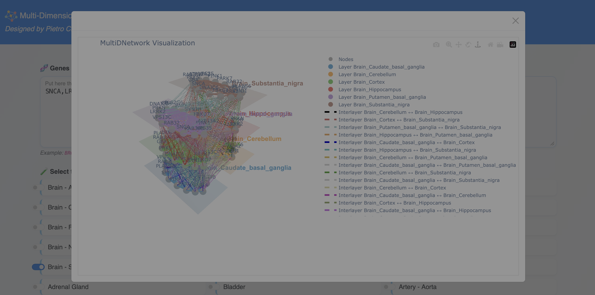

# multi-DGeNe

**Multi-Dimensional Gene Network inference across human tissues**

`multi-DGeNe` is a Python-based tool for constructing multidimensional gene networks from multi-tissue transcriptomic data. It combines within-tissue gene co-expression with cross-tissue expression relationships in a single network representation.

Each tissue is represented as a network layer. Genes are replicated across the selected layers for interlayer inference, while intralayer edges are described via co-expression within a tissue. In interlayer edges the cross-tissue relationships are described, according to a (user-selectable) inference mode.

This tool can be used directly from Python or through a browser-based graphical interface. The latter acts as a front end to the same `multi-DGeNe` inference core; it does not implement a separate analytical procedure.

---

## Main features

- construction of **multi-tissue, multidimensional gene networks**;
- within-tissue **co-expression inference** using Pearson correlation;
- global **Benjamini-Hochberg false-discovery-rate correction** within each inference stage;
- independently configurable significance thresholds for **intralayer** and **interlayer** inference;
- configurable intralayer correlation interval;
- three alternative definitions of cross-tissue connectivity:
  - `equal_exp`: non-differential expression between tissues;
  - `diff_exp`: differential expression between tissues;
  - `diff_co_exp`: differential co-expression between tissues;
- evaluation of **all selected tissue pairs**, rather than only adjacent layers;
- GTEx Analysis Release V10 support;
- edge-list and adjacency-list export;
- programmatic access to layers, nodes and edges;
- interactive browser-based network visualisation;
- graphical user interface for users who do not wish to configure analyses directly in Python.

---

## Reference
If you use `multi-DGeNe` in scientific work, please cite the accompanying multi-DGeNe manuscript. Full bibliographic details can be added here once the article is published.

**[Paper is in reviewing step, we report here DOI for scientific and methodological information]**


## Data sources

Actually, the data souce is centred on **GTEx Analysis (v.10)**.

`multi-DGeNe` uses two forms of expression data:

- **TPM values**, retrieved from the GTEx API, for intralayer co-expression and differential co-expression;
- **raw read counts**, loaded locally, for `equal_exp` and `diff_exp`.

Gene symbols are mapped to Ensembl identifiers using the local metadata file.

The data directory is expected to contain at least:

```text
app/data/
├── metadata.csv
├── tissues.csv
└── gene_read_counts_by_tissue/
    ├── gene_reads_v10_<tissue>.gct.gz
    └── ...
```

Tissue names passed to the Python API must use the GTEx `tissueSiteDetailId` identifiers, for example:

```text
Brain_Cortex
Brain_Substantia_nigra
Brain_Hippocampus
Heart_Left_Ventricle
Lung
```

The available identifiers can be found in `app/data/tissues.csv`.

Note that TPM values are retrieved dynamically, therefore, an internet connection is required during network construction in order to retrieve data via GTEx API.

---

## Installation

Clone the repository:

```bash
git clone https://github.com/pietrocinaglia/multidgene.git
cd multidgene
```

Creating an isolated Python environment is recommended:

```bash
python -m venv .venv
```

Activate it on Linux/MacOS:

```bash
source .venv/bin/activate
```

or on Windows:

```powershell
.venv\Scripts\Activate.ps1
```

Install the required dependencies:

```bash
pip install -r app/requirements.txt
```

The repository currently uses a source-based layout rather than requiring installation as a published Python package.

---

## (1) Quick start: Use `MultiDGeNe` as framework (w/o GUI)

The following example constructs a three-layer differential-co-expression network for five genes.

```python
from app.multidgene import MultiDGeNe

model = MultiDGeNe(
    genes_of_interest=[
        "SNCA",
        "LRRK2",
        "PRKN",
        "PINK1",
        "GBA",
    ],
    tissues_of_interest=[
        "Brain_Cortex",
        "Brain_Substantia_nigra",
        "Brain_Hippocampus",
    ],
    p_threshold_intralayer=0.05,
    p_threshold_interlayer=0.05,
    s_threshold=[0.5, 0.9],
    data_path="app/data/",
    mode="diff_co_exp",
    verbose=True,
)

network, edge_colours = model.construct_multidimensional_network()
```

The resulting `network` is a `MultiDNetwork` object backed by a NetworkX `MultiDiGraph`.

### Inspect the network

```python
print(network.get_layers())
print(network.get_nodes())
print(network.get_edges())
```

Retrieve the nodes or edges of a specific layer:

```python
cortex_nodes = network.get_nodes("Brain_Cortex")
cortex_edges = network.get_edges("Brain_Cortex")
```

### Export the network

Write an edge list including edge weights:

```python
network.write_edge_list(
    output_path="multidimensional_network.csv",
    data=True,
)
```

Each exported row has the form:

```text
gene_1,gene_2,layer_1,layer_2,weight
```

where `weight` is the Benjamini-Hochberg-adjusted p-value associated with the retained edge.

An adjacency-list representation can also be written:

```python
network.write_adjacency_list("multidimensional_network.adjlist")
```

### Generate an interactive visualisation

```python
network.generate_3d_plotly(
    height_px=800,
    output_path="multidimensional_network.html",
)
```

The generated HTML file can be opened in a web browser for interactive inspection of the multidimensional network.

---

## (2) Quick start: Use `MultiDGeNe` via Graphical User Interface (GUI)

A browser-based graphical interface is provided as a front end to the same Python inference core.

From the repository root, start the application with:

```bash
python app/app.py
```

By default, the Flask development server is available at:

```text
http://127.0.0.1:5000
```

The interface allows the user to:

1. enter gene symbols, either comma-separated or one per line;
2. select GTEx tissues to use as network layers;
3. choose the interlayer inference mode;
4. configure the statistical thresholds exposed by the inference core;
5. generate the network;
6. inspect the resulting multidimensional network interactively in the browser.

The GUI is deliberately thin: it collects the analysis settings, calls `MultiDGeNe`, and presents the resulting network. Network inference is performed by the same core methods used by the Python API.

<!--
Add the final GUI screenshot before release, for example:


-->


---

## Choosing an interlayer mode

Only one interlayer mode is used for a network-construction run.

| Mode | Interlayer object | Interpretation | Expression data |
|---|---|---|---|
| `equal_exp` | Same gene across two tissues | No statistically significant expression difference detected | Raw read counts |
| `diff_exp` | Same gene across two tissues | Significant expression difference | Raw read counts |
| `diff_co_exp` | Gene pair across two tissues | Significant difference between within-tissue correlations | TPM |

In every mode, the intralayer component remains a within-tissue co-expression network.

---

## Main parameters

| Parameter | Type | Default | Description |
|---|---|---:|---|
| `genes_of_interest` | `list` | required | Gene symbols to include in the network |
| `tissues_of_interest` | `list` | `[]` | GTEx tissue identifiers to analyse; provide an explicit list for the current end-to-end workflow |
| `p_threshold_intralayer` | `float` | `0.05` | Adjusted p-value threshold for intralayer co-expression |
| `p_threshold_interlayer` | `float` | `0.05` | Adjusted p-value threshold for interlayer inference |
| `s_threshold` | `list` | `[0.5, 0.9]` | Strict lower and upper bounds for intralayer Pearson correlation |
| `data_path` | `str` | `None` | Directory containing local metadata and raw-count data |
| `mode` | `str` | `equal_exp` | Interlayer inference mode |
| `verbose` | `bool` | `False` | Print progress information |

The thresholds are analysis parameters and should be selected according to the intended application; the defaults are not intended as universal biological cut-offs.

---

## Reproducibility and scope

`multi-DGeNe` is designed to construct and compare multidimensional gene-network representations. An inferred edge represents a relationship supported by the statistical rule selected for that inference mode; it should not automatically be interpreted as a causal, regulatory or disease-specific interaction.

The current GTEx-centred workflow does not itself constitute a disease case-control analysis. Biological interpretation depends on the genes, tissues, study design and validation strategy chosen by the user.

---

## Graphical User Interface

The Graphical User Interface (GUI) provides access to the main multi-DGeNe parameters and supports interactive inspection of the inferred multidimensional network.





The network visualisation is fully interactive, allowing users to zoom, rotate, filter and adjust the displayed network according to their analytical needs.

---

## Licence

`multi-DGeNe` is released under the **MIT Licence**. See `LICENSE` for details.


